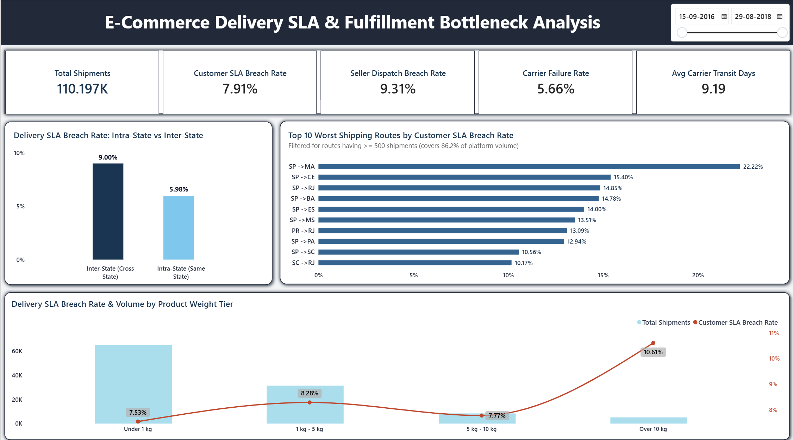

# Supply Chain SLA Diagnostic & Fulfillment Bottleneck Analysis

> **An end-to-end supply chain analytics project diagnosing fulfillment lifecycle failures across 110.2K e-commerce shipments. Built using MySQL and an interactive Power BI dashboard.**

---

## Dashboard Preview

### Page 1: Executive SLA Diagnostic


### Page 2: Shipping Corridors & Weight Risk


---

## 1. Executive Summary & Business Question
- **Business Question:** *"Where in the fulfillment lifecycle are delivery delays originating—seller dispatch or courier transit—and which specific shipping corridors and product categories systematically breach promised delivery SLAs?"*
- **Scope:** 110,197 delivered order items from the Brazilian Olist E-Commerce dataset (2016–2018).
- **Core Diagnosis:** Out of 110.2K shipments, **8,722 breached promised delivery dates (7.91% SLA Breach Rate)**. Root-cause decomposition proves that **71.63% of breaches originate during Carrier Transit**, while **28.37% from Seller Dispatch Delays**.

---

## 2. Executive Scorecard

| Metric | Value | Significance |
| :--- | :--- | :--- |
| **Total Shipments** | **110.197K** | Total completed line items delivered |
| **Customer SLA Breach Rate** | **7.91%** | Orders missing promised delivery date (8,722 orders) |
| **Seller Dispatch Breach Rate** | **9.31%** | Orders handed off past seller shipping limit date |
| **Carrier Failure Rate** | **5.66%** | On-time seller handoff, but failed during transit |
| **Avg Carrier Transit Days** | **9.19 Days** | Average road transit duration |
| **Primary Root Cause** | **Carrier Transit (71.63%)** | 6,248 of 8,722 late orders failed in carrier transit |
| **Top At-Risk Corridor** | **SP -> MA (22.22%)** | Worst route in terms of customer SLA breach (1 in 5 orders delayed) |
| **Top At-Risk Category** | **Audio (12.71%)** | Highest breach rate among categories |

---

## 3. Key Findings: Where Delays Originate
- **Carrier vs. Seller Bottleneck:** **71.63%** of late deliveries happen while the parcel is in road transit.
- **Inter-State Risk:** Cross-state deliveries experience a **9.00% breach rate**, which is **50.5% higher** than intra-state shipments (**5.98%**).
- **Critical Corridors: `SP -> MA` is the worst route at **22.22% breach rate**, followed by `SP -> CE` (**15.40%**), `SP -> RJ` (**14.85%**), and `SP -> BA` (**14.78%**).
- **Vulnerable Categories:** Electronics and home goods lead SLA failures—**Audio (12.71%)**, **Home Comfort (10.26%)**, and **Construction Tools (9.97%)**.
- **Weight Tier Spike:** Packages **over 10 kg** jump to a **10.61% breach rate** (a **40.9% increase** over packages under 1 kg at **7.53%**).

---

## 4. Threshold Logic & Statistical Defense
- **Categories (>= 300 shipments):** Retains 35 categories covering **~95% of platform volume**, filtering out low-sample noise (e.g., categories with 2 orders showing 100% false-alarm breach rates).
- **Route Corridors (>= 500 shipments):** Isolates 30 core commercial trunk routes covering **86% of logistics volume** (~1 dispatch/day over 20 months).
---

## 5. Strategic Recommendations: What to Fix
1. **Dynamic SLA Lead Times:** Add a **3–4 day dynamic buffer** on routes (`SP -> MA`, `SP -> CE`, `SP -> BA`) at checkout to match real transit capacity.
2. **Dedicated Heavy weight carriers:** Contract dedicated carriers for bulky goods (**>10 kg**) to fix **10.61% breach rate**.
3. **Regional Warehousing :** Move more volume product categories closer to regional hubs, shifting high-risk inter-state routes (**9.00%**) into local intra-state deliveries (**5.98%**).
4. **Carrier Performance Penalties: ** Enforce SLA penalty clauses for carriers failing an 8% breach threshold.

---

## 6. Tech Stack
- **MySQL:** Data ingestion via `LOAD DATA LOCAL INFILE`, relational joins, and engineered the analytical view `delivery_sla_analysis`.
- **Power BI:** Built 2-page executive report with custom KPIs, visuals and optimized DAX measures.


---

## 8. Repository Layout
```plaintext
├── dashboard_image1.jpg             # Page 1: Executive SLA Diagnostic
├── dashboard_image2.png             # Page 2: Shipping Corridors & Weight Risk
├── SQL Script.sql                   # MySQL, ingestion, and analytical view
├── dashboard.pbix                   # Power BI dashboard & DAX
├── Project_summary.pdf              # Project Summary
└── README.md                        # Readme
